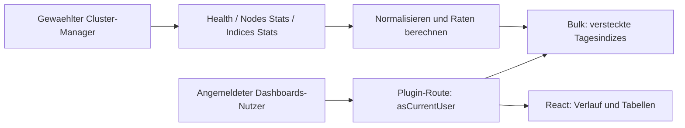

# Architektur und Messwerte

## Ablauf

Ein eigener begrenzter Threadpool fuehrt jeweils eine Erfassung aus. Es gibt
keine ueberlappenden Polls und keine Arbeit auf Transport- oder Scheduler-Threads.
Der Collector prueft die Cluster-Manager-Rolle vor der Erfassung und nochmals
vor dem Schreiben. Bei einem Rollenwechsel ist die naechste Rate zunaechst leer.
Das ist keine verteilte Exactly-once-Garantie; waehrend eines Fuehrungswechsels
koennen sehr nahe Samples oder eine Luecke entstehen.

Anfragen und Schreibvorgaenge haben ein Timeout. Teilweise fehlgeschlagene
Nodes-/Shard-Stats werden nicht als vollstaendige Gesamtwerte ausgegeben.
Fehler werden geloggt und bei der naechsten Erfassung erneut versucht; keine
unbegrenzte Warteschlange und kein Nachholen ausgefallener Intervalle.

Ein Tagesindex hat ein Primaershard und automatisch null bis eine Replik,
abhaengig von der Knotenzahl. Mapping: `dynamic: strict`, `schema_version: 1`.
Das Plugin haelt nur die vorherigen Zaehler im Speicher und prueft den Index
erneut nach einem Fehler. Es benoetigt keine Konfiguration in Dashboards.

## Dokumente

Jede Erfassung verwendet denselben UTC-Zeitstempel fuer drei Arten:

| `kind` | Identitaet | Beispiele |
| --- | --- | --- |
| `cluster` | `cluster_uuid` | Health, Shards, Knoten, Dokumente, Raten |
| `node` | `node_id` | CPU, Heap, Uptime, Dateisystem, Threadpools, Raten |
| `index` | `index_uuid` | Name, Primaerdokumente/-speicher, Raten |

Der Zeitpunkt bezeichnet den Anfang der Erfassung, keine atomare Momentaufnahme
aller Nodes und Indizes. Die API liest Tabellen passend zum neuesten Cluster-
Sample. Ein Bulk kann bei einzelnen Fehlern teilweise geschrieben worden sein;
die folgende Erfassung versucht es neu. Bei hohen Schreiblasten normale kleine
Unterschiede zwischen den nacheinander abgefragten APIs beruecksichtigen.

## Bedeutung der Metriken

- `index_rate`: Differenz primaerer Indexierungszaehler geteilt durch die echte
  Zeit zwischen den Samples; keine Replikverdopplung in Cluster-/Indexwerten.
- `search_rate`: Anzahl der Shard-Abfragen pro Sekunde, einschliesslich Repliken;
  nicht gleich der Anzahl externer REST-Suchanfragen.
- `*_latency_ms`: Differenz der aufsummierten Bearbeitungszeit pro abgeschlossener
  Operation. Kein Perzentil und keine Ende-zu-Ende-Latenz; bei null Operationen leer.
- CPU: Betriebssystemwert je Knoten; im Cluster Mittel der verfuegbaren Werte.
  In virtuellen Umgebungen kann das ein Hostwert sein, kein Container-Quota-Wert.
- Heap: Clusterwert gewichtet nach maximalem JVM Heap, kein einfacher Prozentmittelwert.
- Knoten-Dokumente/-speicher: lokale Shardkopien einschliesslich Repliken und interner Indizes.
- Cluster-/Index-Dokumente/-speicher: Primaerwerte der Indices-Stats-Auswahl.
  Eigene Monitoring-Indizes werden ausgeschlossen; versteckte Plattformindizes
  haengen von der Wildcard-Auswahl der Stats-API ab.

Zaehler-Resets und JVM-Neustarts ergeben `null` statt negative Raten. Auch die
erste Erfassung hat keine Rate. Indizes werden ueber ihre UUID unterschieden,
sodass Loeschen und Neuanlegen nicht miteinander verrechnet werden.

## Anzeige und Grenzen

Die API begrenzt Zeitraum (bis 7 Tage), Bucketzahl (ungefaehr 120), Knoten
(1.000) und Indexdetails (10.000). Sie liest nur den festen Monitoring-Praefix;
Nutzer koennen keinen beliebigen Indexnamen fuer privilegierte Abfragen einschleusen.
History-Buckets mitteln Messwerte, kleine Unterschiede durch Rundung sind normal.
Leere Buckets bleiben leer, statt Ausfaelle mit Nullen oder Linien zu verdecken.
Die Anzeige pollt sequenziell, bricht beim Unmount ab und zeigt Ladefehler sowie
veraltete Daten explizit an.

Der eigene Cluster ist zugleich Speicher und Messobjekt. Vollstaendige Ausfaelle,
volle Datentraeger oder verlorene Daten betreffen daher auch das Monitoring.
Fuer unabhaengige Verfuegbarkeitsalarme wird weiterhin eine externe Ueberwachung
benoetigt. Langfristige Downsampling-/Rollup-Stufen sind nicht implementiert.
