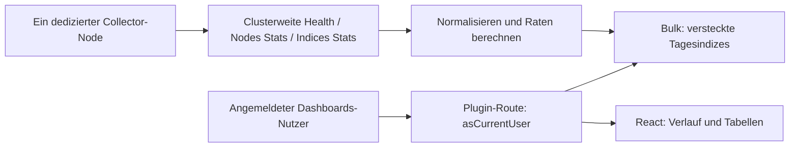

# Architektur und Messwerte

## Ablauf

Ein eigener begrenzter Threadpool fuehrt jeweils eine Erfassung aus. Es gibt
keine ueberlappenden Polls und keine Arbeit auf Transport- oder Scheduler-Threads.
Der Collector arbeitet auf dem einen Node, auf dem das Plugin aktiv installiert
ist. Er ist unabhaengig von Node-Rollen und Manager-Wahlen. Alle Abfragen bleiben
clusterweit; der interne NodeClient nutzt dafuer Standardaktionen, die kein
Monitoring-Plugin auf den anderen Nodes voraussetzen. Es gibt keine verteilte
Collector-Wahl oder Sperre. Mehrere aktive Installationen erzeugen parallele Samples.
Ein Neustart des Collectors verwirft die vorherige Ratenbasis.

Anfragen und Schreibvorgaenge haben ein Timeout. Teilweise fehlgeschlagene
Nodes-/Shard-Stats werden nicht als vollstaendige Gesamtwerte ausgegeben.
Fehler werden geloggt und bei der naechsten Erfassung erneut versucht; keine
unbegrenzte Warteschlange und kein Nachholen ausgefallener Intervalle.

Ein Tagesindex hat ein Primaershard und automatisch null bis eine Replik,
abhaengig von der Knotenzahl. Mapping: `dynamic: strict`, `schema_version: 2`.
Neue Felder werden bei der ersten Erfassung eines vorhandenen Tagesindex mit
einem additiven Put-Mapping ergaenzt. Vorhandene Feldtypen und Daten bleiben erhalten.
Das Plugin haelt nur die vorherigen Zaehler im Speicher und prueft den Index
erneut nach einem Fehler. Es benoetigt keine Konfiguration in Dashboards.

## Dokumente

Jede Erfassung verwendet denselben UTC-Zeitstempel fuer fuenf Arten:

| `kind` | Identitaet | Beispiele |
| --- | --- | --- |
| `cluster` | `cluster_uuid` | Health, Shards, Knoten, Dokumente, Raten |
| `node` | `node_id` | CPU, Heap, Uptime, Dateisystem, Threadpools, Raten |
| `index` | `index_uuid` | Name, Primaerdokumente/-speicher, Raten |
| `pipeline` | `pipeline_uid` | Quelle, Node, Pipeline, Events, Fehler, Queue, Prozessoren |
| `logstash` | `node_id` | Lokale Logstash-Instanz, Version, JVM, CPU, Events |

Der Zeitpunkt bezeichnet den Anfang der Erfassung, keine atomare Momentaufnahme
aller Nodes und Indizes. Die API liest Tabellen passend zum neuesten Cluster-
Sample. Ein Bulk kann bei einzelnen Fehlern teilweise geschrieben worden sein;
die folgende Erfassung versucht es neu. Bei hohen Schreiblasten normale kleine
Unterschiede zwischen den nacheinander abgefragten APIs beruecksichtigen.

## Bedeutung der Metriken

- `index_rate`: Differenz primaerer Indexierungszaehler geteilt durch die echte
  Zeit zwischen den Samples; keine Replikverdopplung in Cluster-/Indexwerten.
- `search_rate`: Anzahl der Shard-Abfragen pro Sekunde, einschliesslich Repliken;
  nicht gleich der Anzahl externer REST-Suchanfragen.
- `*_latency_ms`: Differenz der aufsummierten Bearbeitungszeit pro abgeschlossener
  Operation. Kein Perzentil und keine Ende-zu-Ende-Latenz; bei null Operationen leer.
- CPU: Betriebssystemwert je Knoten; im Cluster Mittel der verfuegbaren Werte.
  In virtuellen Umgebungen kann das ein Hostwert sein, kein Container-Quota-Wert.
- Heap: Clusterwert gewichtet nach maximalem JVM Heap, kein einfacher Prozentmittelwert.
- Knoten-Dokumente/-speicher: lokale Shardkopien einschliesslich Repliken und interner Indizes.
- Cluster-/Index-Dokumente/-speicher: Primaerwerte der Indices-Stats-Auswahl.
  Eigene Monitoring-Indizes werden ausgeschlossen; versteckte Plattformindizes
  haengen von der Wildcard-Auswahl der Stats-API ab.

Zaehler-Resets und JVM-Neustarts ergeben `null` statt negative Raten. Auch die
erste Erfassung hat keine Rate. Indizes werden ueber ihre UUID unterschieden,
sodass Loeschen und Neuanlegen nicht miteinander verrechnet werden.

## Anzeige und Grenzen

Die API begrenzt Zeitraum (bis 7 Tage), Bucketzahl (ungefaehr 120), Knoten
(1.000) und Indexdetails (10.000). Sie liest nur den festen Monitoring-Praefix;
Nutzer koennen keinen beliebigen Indexnamen fuer privilegierte Abfragen einschleusen.
History-Buckets mitteln Messwerte, kleine Unterschiede durch Rundung sind normal.
Historien sind zusaetzlich auf die UUID des aktuell gemessenen Clusters begrenzt.
Leere Buckets bleiben leer, statt Ausfaelle mit Nullen oder Linien zu verdecken.
Die Anzeige pollt sequenziell, bricht beim Unmount ab und zeigt Ladefehler sowie
veraltete Daten explizit an.

Der eigene Cluster ist zugleich Speicher und Messobjekt. Vollstaendige Ausfaelle,
volle Datentraeger oder verlorene Daten betreffen daher auch das Monitoring.
Fuer unabhaengige Verfuegbarkeitsalarme wird weiterhin eine externe Ueberwachung
benoetigt. Langfristige Downsampling-/Rollup-Stufen sind nicht implementiert.

## Pipeline-Erfassung

OpenSearch liefert Ingest-Statistiken in Nodes Stats. Jede Pipeline wird pro
Node getrennt gespeichert, damit kumulative Zaehler eindeutig bleiben.
Logstash wird optional ueber maximal 16 explizite Basis-URLs aus der statischen
Einstellung stack_monitoring.logstash.urls gelesen. Default ist 127.0.0.1:9600.
Die Plugin-Policy erlaubt ausgehende Socket-Verbindungen zu diesen frei
konfigurierbaren Hosts/Ports. Weiterleitungen, Zugangsdaten in URLs sowie Query-
und Fragmentteile werden nicht akzeptiert. Pipeline-Konfiguration wird nicht gespeichert.
Connect-/Read-Timeouts sind 1/1,5 Sekunden; Antworten sind auf 4 MiB begrenzt.
Die Abfragen laufen begrenzt nacheinander im Collector-Worker; langsame Ziele
verlaengern die reale Sample-Periode. TLS prueft Zertifikat/Hostname ueber den
JVM-Truststore. Zusaetzliche API-Authentifizierung ist noch nicht implementiert.
Fehlgeschlagene Ziele werden mit logstash_failed_targets/logstash_targets erfasst.
Erreichbare Instanzen und OpenSearch werden weiterhin gespeichert. Mehrere URLs
derselben Logstash-UUID werden innerhalb eines Samples zusammengefuehrt.
Der aktuelle Gesamt-Durchsatz summiert die erreichbaren Instanzen. In
History-Buckets wird erst je Node gemittelt und anschliessend ueber Nodes addiert;
mehrere Samples pro Bucket vervielfachen dadurch keine Rate. Leere Buckets und
fehlende Raten bleiben leer. CPU/Heap in der Logstash-Uebersicht sind Node-Mittelwerte.

Maximal 1.000 Ingest-Pipelines je Node und 1.000 Pipelines je Logstash-Instanz,
mit bis zu 200 Prozessor-/Plugin-Metriken je Pipeline. Diese Komponenten bleiben
in _source; das Mapping indiziert ihre beliebigen Namen nicht (enabled: false).
Die API liefert maximal 10.000 Pipeline-Zeilen je Sample.
Logstash liefert keinen allgemeinen Fehlerzaehler je Event; dieser bleibt leer.
Ingest-Outputzaehler enthalten erfolgreiche Abschluesse (Gesamtzahl minus Fehler).
Die mittlere Event-Arbeitszeit verwendet die Differenz des Inputzaehlers als Nenner.
Nicht endliche Flow-Werte (Infinity) bleiben ebenfalls leer.
JVM-Neustarts und Pipeline-Epochenwechsel verwerfen die vorherige Ratenbasis.

Die Pipeline-Ansicht zeigt die gemeldeten Stufen. Die Stats-API liefert keinen
vollstaendigen Graphen mit Bedingungen; die Oberflaeche erfindet keine Verbindungen.
Detailseiten verwenden URL-Hashes und unterstuetzen Browser-Zurueck und Direktlinks.

## Shards und Indizes eines Nodes (ab 0.4.0)

Node-Dokumente enthalten einen Routing-Snapshot in `allocations` (nicht separat
indiziert). Quelle ist die lokale ClusterState-Kopie des Collector-Nodes.
Erfasst werden alle dem Node zugeordneten Kopien einschliesslich System- und
Monitoring-Indizes. Nicht zugewiesene Shards werden keinem Node zugerechnet.
Bei Relocation erscheinen Quelle und initialisierendes Ziel jeweils auf ihrem
eigenen Node. Primary/Replica bezeichnet die Kopienrolle, nicht den Clusterstatus.

Shard-Stats werden ueber Index-UUID, Shard-ID, Node-ID und Allocation-ID zugeordnet.
Bei zwischenzeitlich verschobenen Kopien oder nicht abgefragten Monitoring-Indizes
bleiben Dokumente/Daten leer. Indexsummen in der Node-Ansicht entstehen nur aus
lokalen Kopien; bei fehlenden Stats wird keine unvollstaendige Summe als vollstaendig
ausgegeben. Sie sind nicht mit den primaeren Cluster-/Indexwerten gleichzusetzen.

Pro Node sind maximal 10.000 Detailzeilen gespeichert. Gesamtzaehler fuer Indizes,
Primary und Replica enthalten weiterhin alle zugewiesenen Kopien. Bei Begrenzung
zeigt die UI einen Hinweis; Tabellen und Zustandszaehler betreffen dann nur die
erfassten Zeilen. Der API-Uebersichtspayload schliesst `allocations` aus.
Nur fuer einen ausgewaehlten Node wird dessen Snapshot zum exakt gleichen
Cluster-UUID/Zeitstempel ueber `asCurrentUser` geladen (`allocationNode`).
Alte Messungen ohne dieses Feld bleiben lesbar und werden nicht mit null Shards
verwechselt. Der Zeitraum beeinflusst die Diagramme; Routing-Tabellen zeigen den
angegebenen aktuellen Sample-Zeitpunkt. Paginierung und Filter bleiben bei
automatischer Aktualisierung erhalten; eine neue Suchanfrage beginnt auf Seite 1.

## Shard Activity (ab 0.6.0)

Der Collector nutzt die native Recovery-Aktion fuer offene Indizes einschliesslich
versteckter Indizes, ohne einzelne Dateinamen anzufordern. Das Cluster-Sample
speichert bis zu 200 Recovery-Zeilen als nicht indiziertes Objektarray. Laufende
Recoveries werden vor abgeschlossenen einsortiert. Abgeschlossene Eintraege sind
auf den Aufbewahrungszeitraum begrenzt. Die UI zeigt aktive Eintraege auch dann,
wenn deren Start vor dem ausgewaehlten Zeitraum liegt; DONE-Eintraege werden
anhand ihres Abschlusszeitpunkts gefiltert. Die API liefert nur die letzte
Recovery je aktueller Shard-Kopie, keine vollstaendige Ereignishistorie.

Datei-/Byte-Fortschritt bezieht sich auf tatsaechlich zu uebertragende Daten;
wiederverwendete Dateien werden separat ausgewiesen. Unbekannte Translog-Gesamtwerte
bleiben leer. Teilweise fehlgeschlagene Recovery-Antworten werden als nicht
verfuegbar markiert, waehrend die uebrigen Monitoring-Metriken weiterlaufen.

Der Diagrammkatalog trennt Standard- und Zusatzdiagramme fuer jede Ansicht.
Der Schalter liegt bei den Diagrammen und erscheint nicht in reinen Tabellen-
Untertabs. So bleibt die Standardansicht kompakt und der Schalter hat immer
eine sichtbare Wirkung, auch in der Cluster-Uebersicht.
